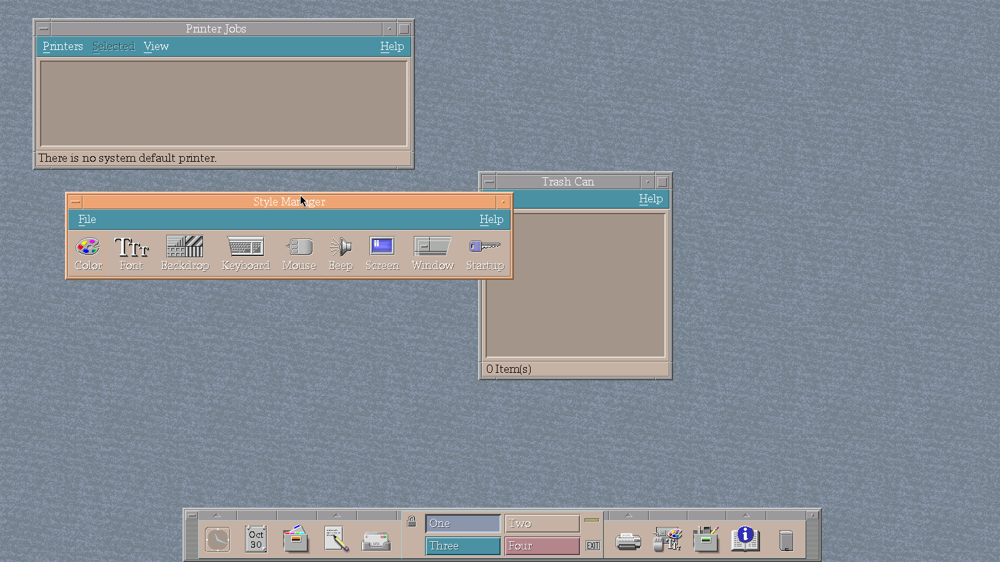

# Modern Linux for the Sun Ultra 10

A scripted, repeatable way to put a lean, fully 64-bit Debian (sysvinit, no systemd) with a current kernel onto a
Sun Ultra 10 (UltraSPARC IIi, ~128 MB RAM, CMD646 IDE, ATI Mach64 GP "Rage PRO", 4 MB VRAM). Everything is built on a PC; the Ultra only boots.


<p align="center">
  
</p>

## Requirements

An x86-64 Debian/Ubuntu PC with about 15 GB free and network access (sources are downloaded and signature-checked by the scripts):

```
sudo apt install debootstrap debian-ports-archive-keyring qemu-user qemu-user-binfmt \
     gcc-sparc64-linux-gnu binutils-sparc64-linux-gnu make bison flex gawk curl gpg openssl python3 bc libssl-dev
```

(`qemu-user-binfmt` must register `qemu-sparc64`; `build-debian.sh` checks this.) Nothing is installed on the PC besides these packages.

## Settings

`config/defaults.conf` holds the machine settings (hostname, address, apt proxy, root password, optional ordinary user). The defaults are
placeholders (password `root`, address 192.168.2.20). **Put your own values in `config/local.conf`** – same `KEY=value` format, read after
the defaults, and git-ignored – for example:

```
ROOT_PASSWORD=something-better
USER_NAME=alice
USER_PASSWORD=alices-password
USER_SSH_KEY_FILE=/home/alice/.ssh/id_ed25519.pub
```

`USER_NAME` creates an ordinary user (uid 1000, groups from `USER_GROUPS`, `sudo` included) with the same X session as root;
`--user NAME --user-password PW` do it for a single build. `config/ultra10-baseline.conf` and `ultra10-with-x.conf` are the package lists.

## Workflow (run on an x86-64 Linux PC)

1. `tools/build-grub.sh` – GRUB 2.14 for sparc64-ieee1275 (patched for a cross-endian blocklist bug) into `build/grub-root`.
2. `tools/build-kernel.sh` – Linux 7.3 from Debian's sparc64 config plus `tools/kernel/ultra10.fragment`
   (boot-path drivers built in, so no initramfs) into `build/kernel/out/7.3-ultra10`.
3. `tools/build-debian.sh [--with-x | --with-cde]` (as a normal user it re-runs itself in a user namespace; where AppArmor forbids that, as on Ubuntu 24.04+, use `sudo`) – Debian ports sid root filesystem via debootstrap + qemu-user (binfmt `qemu-sparc64`
   must be registered with the F flag; package `qemu-user-static`). Output: `build/debian/rootfs.tar`.
   Options: `--config --hostname --iface --addr --gateway --dns --root-password --proxy`. Work happens in `/var/tmp/ultra10-debian`.
4. `sudo tools/prepare-disk.sh --disk /dev/sdX --rootfs-tar build/debian/rootfs.tar --kernel-dir build/kernel/out/7.3-ultra10`
   – dry run by default; add `--go --confirm sdX` to write. Creates a Sun disklabel, filesystems, unpacks the rootfs,
   installs the kernel and the GRUB boot block. Refuses the running root disk.
5. `tools/check-boot.sh /dev/sdX1` – read-only check of the boot block.
6. Put the disk in the Ultra and at the OpenBoot prompt: `boot disk`. If the machine's NVRAM battery is dead, OpenBoot forgets `boot-device`/`auto-boot?` at every power-off, so it tries the network first and you press Stop-A and type this each time; only a new NVRAM chip/battery fixes that.

The image is a minimal Debian ports (sid) system with sysvinit: sshd, `inetutils-syslogd` (messages in `/var/log`), two virtual-console
gettys, `fake-hwclock`, `hdparm`, `pciutils`, and `kernel.reboot-cmd=disk` so a reboot from Linux goes straight to `boot disk`. Pass
`--proxy http://HOST:3142` to `build-debian.sh` to have the image use an apt-cacher-ng on your PC for `apt`.

Settings (hostname, interface, address, gateway, DNS, apt proxy, root password) live in `config/defaults.conf`; command-line options
override single values. Defaults: hostname `ultra10`, `eth0` at 192.168.2.20/24 (no gateway), apt proxy `http://192.168.2.3:3142`, sshd with
root password login (`root`) – change these before use on a real network. The image keeps the kernel's interface names (`eth0`, `eth1`)
and not udev's `enp1s1f1`. The build also strips documentation, man pages, translations and the udev hardware-database sources
(about 55 MB), and the kernel's modules are zstd-compressed.

## Hardware notes

- Disk layout: /boot (ext2, starts at sector 0 – GRUB stores absolute sectors), swap (8 KB pages), whole disk, / (ext4).
- The RTC battery may be dead: `fake-hwclock` is installed; `tools/set-time.sh` sets the clock from the PC over ssh.
- IDE DMA works with native IDE drives (a 2000s hard drive: MWDMA2, about 13 MB/s). Some SATA-to-IDE bridge boards never complete
  DMA on the CMD646: pass `--kargs "rootwait libata.force=1.00:pio4"` to `prepare-disk.sh` for such a drive. Never force a DMA
  mode (libata then cannot fall back to PIO and may not boot). `--dma-tests` adds a "PIO mode" and an "IDE trace" GRUB entry
  (select with ctrl-p/ctrl-n in GRUB, or `tools/set-grub-default.sh`; trace with `tools/guest/trace-ata.sh`).
- OpenBoot 3.15 could not open the 80 GB SSDs tried (`open-dev` returned 0), though Linux reads them; the 64 GB and 40 GB drives
  boot. Cause unconfirmed (a size limit is one suspect).
- `tools/guest/bench.sh` is installed as `/root/bench.sh` for memory/disk numbers.

## X desktop and CDE (`--with-x`, `--with-cde`)

`--with-x` adds `config/ultra10-with-x.conf`: Xorg with the fbdev driver at 1600x900, 16-bit (the 4 MB of VRAM rules out 32-bit at that size;
width x height x bytes per pixel must stay under 4,186,112), evdev/Sun input, xterm, Motif/Xaw applications, fonts, nedit, xfe, tkdesk, dillo
and some games. It has no window manager and no display manager of its own.

`--with-cde` is `--with-x` plus the Common Desktop Environment, which is not in Debian: it is built from the CDE 2.5.3 source for sparc64 by
the scripts in `cde/` (see `cde/README.md`) into two packages, `cde-desktop` and `cde-help`, which the image build installs.
`dtlogin` is the display manager and starts at boot.

Screenshots: `tools/screenshot.sh [root@192.168.2.20] [out.png]` runs `fbcat /dev/fb0` on the Ultra over ssh and converts the result locally
with `tools/fbshot-to-png.py` (fbcat gets the byte order of the big-endian 16-bit pixels wrong, so a plain PPM-to-PNG conversion gives
scrambled colours). Default output: `screenshots/shot-<date>-<time>.png`.

## A/B root filesystems

`prepare-disk.sh --ab` makes five slices: 1 `/boot` (ext2, shared), 2 swap (shared), 3 whole disk, 4 `rootfs-a` and 5 `rootfs-b` (ext4, labels
`rootfs-a`/`rootfs-b`; each fstab names its own root by label). GRUB has entries for both kernels x both roots.

To update the inactive root from the running system, with the old one kept as a fallback:
- `tools/push-rootfs-ab.sh --host root@192.168.2.20 [--rootfs-tar build/debian/rootfs.tar] [--go]` – finds the inactive root, formats it, unpacks the
  tar over ssh, copies fstab (with its own label), ssh host keys, network config and the running kernel's modules, and makes it GRUB's default.
  Dry run unless `--go`. Push the kernel first (it copies the running root's modules).
- Switch back later with `tools/set-grub-default.sh`, or pick the other entry in the GRUB menu.

## Network updates (after boot)

- Packages: `apt upgrade` works over the apt proxy in `config/defaults.conf`.
- Kernel: `tools/build-kernel.sh`, then `tools/push-kernel.sh --host root@192.168.2.20 --go` (updates `/boot`, modules and `grub.cfg`,
  keeping the A/B entries); reboot to use it. Older kernels stay selectable in GRUB.
- Disk in hand: `tools/install-kernel.sh` adds a kernel to a prepared disk.

## Other tools

`push-rootfs.sh` – write a rootfs over ssh onto a given root. `set-grub-default.sh` – change GRUB's default entry over ssh.
`set-time.sh` – set the clock from the PC over ssh. `decode-ata-id.py` – decode ATA IDENTIFY data.
